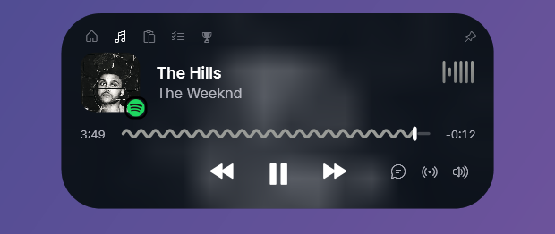
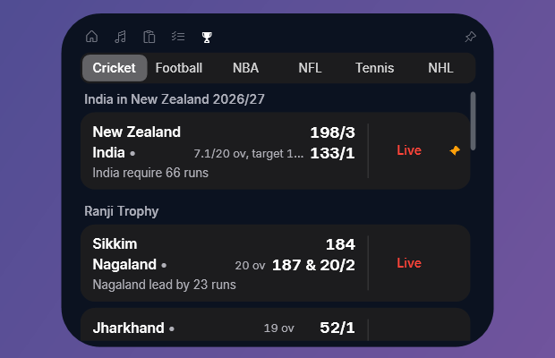
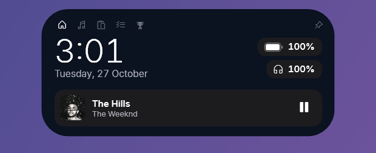
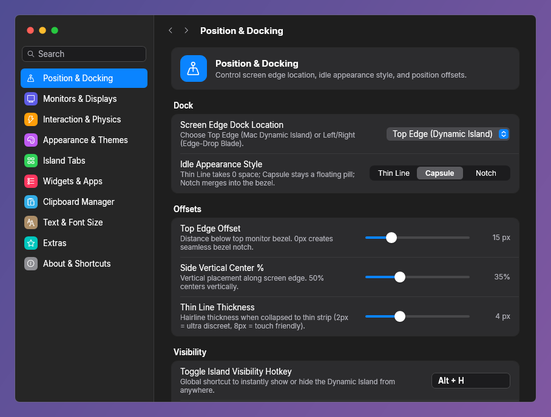

<p align="center">
  
</p>

<h1 align="center">Isle</h1>

<p align="center">
  <b>The iPhone's Dynamic Island, on your Windows PC.</b><br>
  A small black capsule at the top of your screen that shows what's going on: music, timers, live scores, calls, downloads.<br>
  Hover it and it opens into a little control centre.
</p>

---

## What it does

### Now Playing

Works with anything that appears in Windows' media controls: Spotify, YouTube in Chrome or Edge, Apple Music, VLC and more.

- Album art, a seek bar, play / pause / skip, and a waveform that moves with the music
- **Synced lyrics**, in the island or in a floating window
- **Music Radar** names the song that's playing, with Spotify and YouTube links
- Scroll on the speaker icon to change the volume

### Live scores

<p align="center">
  
</p>

Cricket, football, NBA, NFL, tennis and NHL. Open the **Scores** tab and click a match to pin it. The island turns into a live scoreboard, and a banner pops up for the start, goals, wickets and the final result. Click the match again to unpin it.

<p align="center">
  
</p>

### Home

<p align="center">
  
</p>

Shows when nothing is playing: the time and date, your battery and your Bluetooth headphones' battery, the weather, and one click to resume your last song.

### And more

- **Timer, Stopwatch and Focus** (Pomodoro) with a progress ring beside the island
- **Clipboard shelf**: everything you copy, with search, pins, image text (OCR) and Google Lens. Password managers are skipped.
- **Quick launch** for your favourite apps and folders, plus **Notes** and **Tasks** tabs
- **Drop zone**: drag files onto the island to save them to a folder or the clipboard shelf
- **Live activities**: a green call timer while Teams, Zoom, Discord or WhatsApp uses your mic, plus pop-ups for finished downloads, charging and low battery, volume and Caps Lock
- **Privacy dot**: orange while an app uses your microphone, green for the camera
- **Idle widgets** for the collapsed capsule: clock styles, analog clock, calendar, activity rings, CPU and RAM, network speed, weather, next task, animated eyes, a glow orb, or a pet
- **Game Mode**: Isle gets out of the way while you play or watch something full-screen

When two things run at once (say a pinned match and music), the second moves into a small bubble beside the island, just like on iPhone.

## Install

1. Install the **[.NET 8 Desktop Runtime (x64)](https://dotnet.microsoft.com/download/dotnet/8.0)** if you don't already have it.
2. Download **`Isle.exe`** from the [`publish`](publish) folder.
3. Run it. If Windows SmartScreen warns you about an unrecognised app, choose **More info → Run anyway**.

A short welcome tour shows you around on first launch. Isle starts with Windows from then on; you can turn that off in **Settings → Interaction & Physics → Launch on Windows Startup**.

Needs Windows 10 (version 1809 or later) or Windows 11.

## Using it

| To | Do this |
|---|---|
| Open the island | Hover the top edge of the screen (or click, if you prefer that in Settings) |
| Switch tabs | Click the icons along the top, or scroll / two-finger swipe on the island |
| Keep it open | Click the pin in the top-right corner |
| Open the music app | Click the album art |
| Switch between players | Click the small app badge on the album art |
| See through it | Tap **Ctrl** over the island: it fades and your clicks reach the window behind until you move away |
| Hide or show it | Press **Alt + H**, or shake the mouse quickly from side to side |
| Settings, Quit, Floating Lyrics | Right-click the island, use the tray icon, or launch Isle again |

## Settings

<p align="center">
  
</p>

Settings look like macOS System Settings, with a search box. You can:

- dock the island at the top, bottom or either side, as a capsule, a thin line, or a notch merged into the screen edge
- pick which tabs appear and what the idle capsule shows
- change colours, motion and text size

**Appearance → Apple Look** puts everything back to the iPhone style in one click.

## Privacy

- Your settings, clipboard history, notes and tasks stay on your PC, in `%LOCALAPPDATA%\Isle`.
- Isle only goes online for the features you use:
  - live scores, from ESPN's public scoreboard, only while a match is pinned or the Scores tab is open
  - lyrics, from LRCLIB
  - weather, from Open-Meteo, with your rough location from ip-api.com unless you type a city
  - Music Radar, from Shazam
  - Google Lens, only when you send an image to it

## Light on your PC

Isle sits on screen all day, so it's built to stay small. It typically uses **about 10–30 MB** in Task Manager's Memory column, and does no work in the background for features you haven't turned on.

---

<details>
<summary><b>Building from source</b></summary>

Needs the [.NET 8 SDK](https://dotnet.microsoft.com/download/dotnet/8.0).

```
dotnet build
dotnet publish -c Release -r win-x64 --self-contained false -p:PublishSingleFile=true -o publish
```

| Path | What's there |
|---|---|
| `App.cs` | Entry point, single instance, tray icon, shared state |
| `AppSettings.cs` | Every setting |
| `MainWindow.xaml(.cs)` | The island: spring-physics morphing, compact / expanded / pop-up live activities, all tabs |
| `SettingsWindow.cs` | The macOS-style Settings window |
| `Controls\Visuals.cs` | Waveform, seek bar, dot-matrix clock, eyes, pet, rings, battery glyph |
| `Services\` | Media, audio, clipboard / OCR, lyrics, Music Radar, live scores, system info, icons |

</details>

## Credits

Inspired by Apple's Dynamic Island and the Dynamic Edge app for Windows. Isle is not affiliated with Apple.
It uses SF Pro if it's installed and falls back to the bundled [Inter](https://rsms.me/inter/) typeface (SIL Open Font License).
